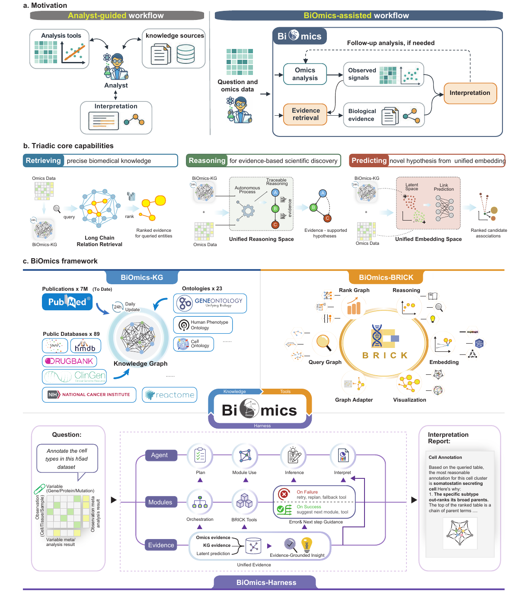

# BiOmics

**Knowledge-guided, traceable multi-omics analysis with BiOmics-KG, BiOmics-BRICK and BiOmics-Harness.**

[](LICENSE)
[](BiOmics/scripts/pyproject.toml)

BiOmics is a bio-reasoning framework that combines a continuously updated biomedical knowledge graph, a modular computational tool layer, and an agent-based orchestration framework. It supports knowledge retrieval, evidence-grounded interpretation, graph representation learning, and association prediction across multi-omics tasks.



## What BiOmics does

BiOmics connects omics data with biological evidence through three complementary operations:

- **Retrieving:** query entities, relationships, neighbours, and multi-hop paths in BiOmics-KG while preserving relation types, source databases, and literature context.
- **Reasoning:** normalize and score evidence, inspect conflicts, construct explanatory paths, and produce traceable reports.
- **Predicting:** integrate omics-derived graphs and KG subgraphs with PCA/UMAP or GRACE embeddings to prioritize candidate associations and generate testable hypotheses.

Applications include cell-type annotation and subtype refinement, differential-expression interpretation, gene enrichment, trajectory inference, variant interpretation and phenotype prediction, protein-association analysis, gene-regulatory-network analysis, and drug repurposing.

## Core components

| Component | Role |
|---|---|
| **BiOmics-KG** | Biomedical knowledge substrate integrating curated ontologies, public databases, and literature-derived evidence with preserved source sentences. |
| **BiOmics-BRICK** | Modular CLI and agent skill for querying, ranking, reasoning, graph adaptation, embedding, and visualization. |
| **BiOmics-Harness** | Agent orchestration for task understanding, planning, tool execution, output checking, bounded retries, and evidence-linked reporting. |

## Repository layout

```text
BiOmics/
├── SKILL.md              # Complete BiOmics agent usage guide
├── references/           # Task-specific workflows and KG source guidance
├── configs/              # Example task and query policies
├── scripts/              # Installable BiOmics-BRICK CLI implementation
└── tests/                # Unit and integration tests

assets/                   # Figures used by this homepage
LICENSE                   # MIT License
README.md                 # This document
```

The main commands provided by BiOmics are:

| Command | Function | Typical use |
|---|---|---|
| `brick qr` | Query | Cell markers, gene–disease associations, paths, and other KG relationships |
| `brick rk` | Rank / Enrich | Prioritize candidates or perform enrichment when an appropriate reference background is available |
| `brick reason` | Reason | Normalize, filter, score, compare, and explain evidence |
| `brick ga` | Graph adapter | Convert DataFrame/AnnData/PAGA objects and merge omics with KG graphs |
| `brick emb` | Graph embedding | Build unified embeddings with PCA/UMAP or optional GRACE |
| `brick pl` | Plot | Static/interactive networks, radial association plots, and TF-regulon plots |
| `brick plan` / `brick workflow` | Orchestration | Materialize inspectable plans and editable task scaffolds |
| `brick agent` | Checked execution | Validate plans, execute safe BiOmics commands, check artifacts, and report failures |

## Quick start

### Install BiOmics in a local environment

**Linux / macOS**

```bash
cd BiOmics/scripts
python3 -m venv .venv
source .venv/bin/activate
python -m pip install --upgrade pip
pip install -e .
```

**Windows PowerShell**

```powershell
cd BiOmics\scripts
python -m venv .venv
.\.venv\Scripts\Activate.ps1
python -m pip install --upgrade pip
pip install -e .
```

The editable installation allows changes under `scripts/` to take effect without reinstalling. To install the optional GRACE runtime instead:

```bash
pip install -e ".[grace]"
```

Verify the installation:

```bash
brick --help
brick agent --help
brick policy --help
brick qr --help
```

The help output should include `qr`, `rk`, `ga`, `pl`, `emb`, `reason`, `plan`, `workflow`, `policy`, and `agent`.

### Other installation options

```bash
# Non-editable installation
pip install .

# Isolated global CLI with pipx
pipx install -e /path/to/BiOmics/scripts

# Run without installing
cd BiOmics/scripts
python cli.py --help
```

If dependency installation fails in a shared Anaconda environment, try:

```bash
pip install -e . --no-deps
pip install pandas requests scipy networkx matplotlib pyvis pydot
pip install scanpy   # optional; required for h5ad and single-cell workflows
```

Requirements and notes:

- Python ≥ 3.9
- Network access for `brick qr`; the default KG API is `https://biomics.dcs.cloud/api`. Set `BRICK_API_BASE_URL` to override it with a custom endpoint.
- Optional [Graphviz](https://graphviz.org/download/) for graph export
- Activate the environment or open a new terminal if `brick` is not found

### Query, rank, and visualize

```bash
# Query T-cell marker genes
brick qr "T cell" --st Cell --tt Gene -r marker_of -o query.csv

# Rank and visualize the candidates
brick rk -i query.csv --rank -o ranked.csv
brick pl radial -i ranked.csv --top-k 10 -o result.png
```

Generate an editable workflow scaffold:

```bash
brick workflow celltype --adata data.h5ad --groupby leiden -o celltype_recipe
brick workflow enrichment --genes geneset.txt -o enrichment_recipe
```

Inspect and edit the generated `commands.sh` or `commands.ps1` before running task-specific analysis.

## Tell your agent (Codex, Claude Code, Hermes, Work Buddy, etc.)

> Fetch the BiOmics repository from https://github.com/BGIResearch/BiOmics/tree/main. Clone the main branch into the current workspace, create an isolated Python virtual environment under `BiOmics/scripts`, and install the package with `python -m pip install -e .`. Verify the installation with `brick --help` and `brick qr --help`, confirm that `qr`, `rk`, `ga`, `emb`, `pl`, `reason`, `plan`, `workflow`, `policy`, and `agent` are registered, troubleshoot any installation failure, and report the repository path, environment path, and validation results.

Alternatively, copy or symlink the `BiOmics/` directory, including `SKILL.md` and its subdirectories, into your agent's skills directory.

### Cursor

```bash
# Personal: ~/.cursor/skills/BiOmics/
# Project: .cursor/skills/BiOmics/
mkdir -p .cursor/skills
cp -r BiOmics .cursor/skills/
```

### Hermes

```bash
# Default: ~/.hermes/skills/BiOmics/
cp -r BiOmics ~/.hermes/skills/

# Alternatively, set HERMES_OPTIONAL_SKILLS_DIR to a directory containing BiOmics.
```

In a Hermes session, use `/skills search BiOmics` or invoke the skill by name.

### Claude Code

```bash
# Personal: ~/.claude/skills/BiOmics/SKILL.md
# Project: .claude/skills/BiOmics/SKILL.md
mkdir -p .claude/skills
cp -r BiOmics .claude/skills/
```

### Codex

```bash
# Project: .agents/skills/BiOmics/
# Global: ~/.agents/skills/BiOmics/
mkdir -p .agents/skills
cp -r BiOmics .agents/skills/
```

Restart the agent if a newly copied skill is not discovered.

## Optional GRACE graph embedding

GRACE is available for analyses in which integrated graph topology should shape the representation. It learns from two perturbed graph views using a shared GCN encoder and a symmetric InfoNCE objective. PCA/UMAP remains the default unless `--method grace` is supplied.

Typical uses include cell-subtype refinement, prioritizing KG candidates near omics observations, and comparing topology-aware and legacy embeddings. Embedding proximity is a prioritization signal, not proof of a biological relationship or causal effect.

Run from `BiOmics/scripts/`:

```bash
pip install -e ".[grace]"

brick emb \
  -a adata_sub.h5ad \
  -i marker_hits.csv \
  --method grace \
  --cell-neighbor \
  --grace-epochs 300 \
  --grace-hidden-dim 32 \
  --seed 20241204 \
  -o adata_grace.h5ad
```

Inputs:

- `-a`: an AnnData `.h5ad` whose `var_names` include genes used by the query CSV
- `-i`: a `brick qr` or `brick rk` CSV containing `path.0.name`, `path.0.type`, `path.2.name`, and `path.2.type`
- `-o`: the output integrated AnnData graph

Add `--cell-neighbor` only when `adata.obsp['connectivities']` already contains a suitable cell–cell graph. Query genes absent from `adata.var_names` are excluded, and the command stops if no query genes remain.

Important parameters:

| Parameter | Default | Purpose |
|---|---:|---|
| `--grace-epochs` | 300 | Contrastive training epochs |
| `--grace-hidden-dim` | 32 | Learned representation width |
| `--grace-layers` | 2 | GCN layers |
| `--grace-edge-drop` | 0.3 | Edge-removal probability in each augmented view |
| `--grace-feature-mask` | 0.3 | Feature-masking probability |
| `--grace-feature-mode` | `projected_identity` | Scalable feature construction |
| `--grace-max-nodes` | 5000 | Safety cap for the all-node objective; `0` disables the cap |
| `--grace-device` | `auto` | CPU, CUDA, or Apple MPS |
| `--distance-metric` | `cosine` | Omics-to-KG distance metric |
| `--seed` | 20241204 | Features, augmentation, initialization, and UMAP |

Inspect the loss curve, verify that embeddings and distances are finite, compare important results with a second seed, and review the original KG relations and provenance. The all-node InfoNCE objective uses O(N²) similarity matrices, so keep the graph biologically focused before raising `--grace-max-nodes`.

Outputs include the learned representations, `X_umap`, the integrated adjacency matrix, cell-by-KG distances, and training metadata. See [`references/grace_embedding.md`](BiOmics/references/grace_embedding.md) for details.

## Extend BiOmics on demand

When the available bricks and their compositions cannot perform a required analysis, the host agent may extend the local BiOmics source code with task-specific methods, adapters, validators, or visualizations. Keep changes scoped, register any new CLI command, preserve inputs and outputs, and validate the extension before using its results.

Refresh the editable installation when needed:

```bash
cd BiOmics/scripts
python -m pip install -e .
```

Run focused tests and a small end-to-end example, and record modified files and validation results. Local task-scoped extensions are not automatically committed, published, or deployed. See the **On-Demand BRICK Extension** section in [`SKILL.md`](BiOmics/SKILL.md).

## Task guides and provenance

Task-specific workflows are available in [`BiOmics/references/`](BiOmics/references/), including:

- [Cell-type annotation](BiOmics/references/celltype_annotation_cli.md)
- [Cell-type refinement](BiOmics/references/celltype_refinement.md)
- [Differential-expression analysis](BiOmics/references/DEG_analysis_cli.md)
- [Gene enrichment](BiOmics/references/gene_enrichment.md)
- [Trajectory analysis](BiOmics/references/trajectory_analysis_cli.md)
- [GWAS causal-SNP interpretation](BiOmics/references/gwas_causal_snps_cli.md)
- [GWAS phenotype prediction](BiOmics/references/gwas_phenotype_prediction_cli.md)
- [Proteome analysis](BiOmics/references/proteome_analysis_cli.md)
- [GRN analysis](BiOmics/references/grn_analysis_cli.md)
- [Drug discovery](BiOmics/references/drug_discovery_cli.md)
- [KG data-source selection](BiOmics/references/kg_data_sources.md)

Execution records, case-study inputs, scripts, intermediate artifacts, and outputs are archived at <https://zenodo.org/records/23800307>. Different analyses may use different KG or software snapshots; consult the corresponding run summaries and manifests for exact versions, parameters, failures, and fallbacks.

Biological findings should be interpreted together with their evidence. Co-occurrence is not causality, functional association is not necessarily physical binding, and embedding proximity is not independent experimental validation.

## License

BiOmics is released under the [MIT License](LICENSE).
